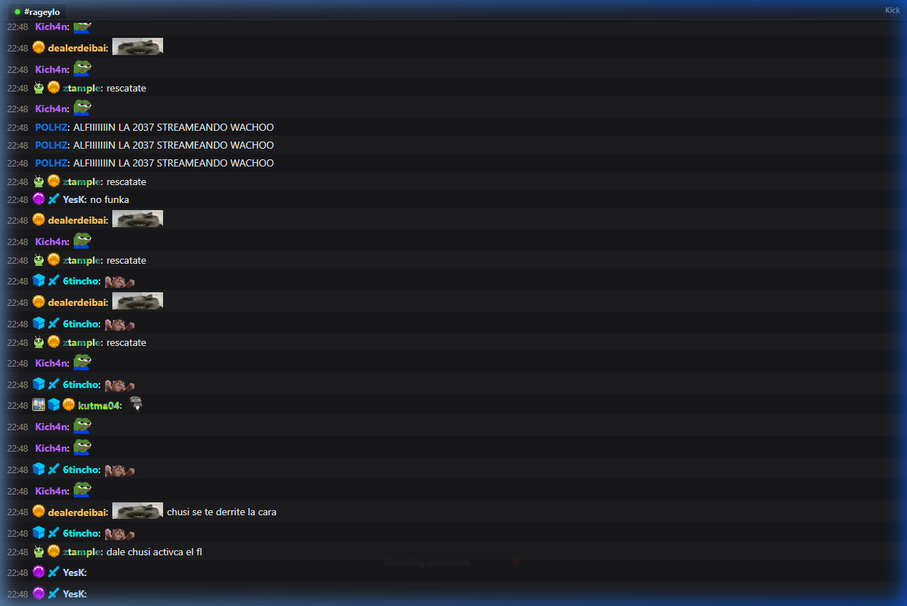

# Chatterino 2 Kick Chat Overlay para OBS Studio 💬🟢

Un overlay de chat para **OBS Studio** con el diseño, tipografía, formato de líneas y estética exacta de la aplicación de escritorio **Chatterino 2** ([github.com/Chatterino/chatterino2](https://github.com/Chatterino/chatterino2)), conectado en tiempo real al canal de Kick de **`rageylo`**.



---

## ✨ Características estilo Chatterino 2

- 🖥️ **Estética idéntica a Chatterino 2 (Tema Oscuro #18181b)**:
  - Formato compacto línea por línea de IRC/Chatterino.
  - Pestaña de split en la cabecera con `#rageylo` e indicador online verde.
  - Marcas de tiempo `[HH:MM]` en gris atenuado (`#8c8c8c`).
  - Fondo alternado sutil entre líneas consecutivas.
  - Resaltado en rojo para menciones (mensajes que contienen `@rageylo` o mencionan al streamer).
  - Tipografía estándar de sistema limpia y nítida (`Segoe UI`, `Roboto`, `Helvetica`).
- 🚫 **Sin logos de Kick**: Los nombres de usuario se muestran limpios en su color original.
- ⚡ **7TV completo**: insignias, colores/paints de nombre (degradados, imágenes y sombras) y emotes de 7TV (globales + del canal de rageylo).
- 🎖️ **Insignias nativas de Kick**: mismas imágenes y orden que en kick.com (founder, sub gifter por tier, suscriptor por meses con la imagen del canal, mod, VIP, OG, verified, broadcaster, staff) - archivos en `badges/`.

---

## 🚀 Cómo usar en OBS Studio

### Opción 1: Servidor Local (Recomendado)
1. Haz doble clic en **`start.bat`** (o ejecuta `python server.py`).
2. Se abrirá tu navegador en:
   ```text
   http://localhost:8000/index.html?channel=rageylo
   ```
3. En **OBS Studio**:
   - En el panel **Fuentes**, presiona **`+`** y selecciona **Navegador** (*Browser Source*).
   - En **URL**, pega: `http://localhost:8000/index.html?channel=rageylo`
   - Configura el **Ancho:** `450` y el **Alto:** `750`.
   - ¡Listo!

---

### Opción 2: Archivo Local Directo (`file:///`)
Si prefieres no iniciar el script de Python:
1. Abre [index.html](file:///c:/Users/alfon/OneDrive/Escritorio/VISUAL/Python/Chat%20overlay%20kick/index.html) en tu navegador.
2. Copia la URL con el canal:
   ```text
   file:///c:/Users/alfon/OneDrive/Escritorio/VISUAL/Python/Chat%20overlay%20kick/index.html?channel=rageylo
   ```
3. Pégalo en la fuente de Navegador en OBS Studio.

---

## ⚙️ Opciones de URL personalizables

Puedes ajustar las opciones agregándolas a la URL:

| Parámetro | Valor por defecto | Descripción |
| :--- | :--- | :--- |
| `channel` | `rageylo` | Canal de Kick al que conectar |
| `size` | `14` | Tamaño de letra (en px, Chatterino usa 14) |
| `timestamps` | `true` | Mostrar/ocultar hora `[HH:MM]` (`true`/`false`) |
| `alt` | `true` | Fondo alternado entre mensajes (`true`/`false`) |
| `header` | `true` | Mostrar cabecera de pestaña `#canal` (`true`/`false`) |
| `badges` | `true` | Mostrar insignias de 7TV y suscriptores (`true`/`false`) |
| `fade` | `0` | Segundos para desvanecer mensaje (`0` = permanente) |

---

## ⌨️ Atajos de teclado
- Presiona **`C`** sobre el overlay para abrir el menú de ajustes de Chatterino.
- Haz clic en **"🧪 Enviar Prueba"** para simular mensajes de prueba con menciones e insignias.

